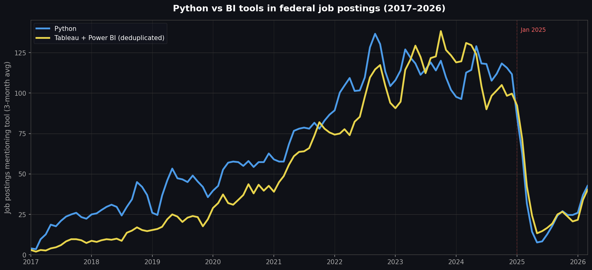

# usajobs-tool-trends

An analysis of tool mentions in federal job postings from 2017 to 2026, using the [`loyoladatamining/usajobs`](https://huggingface.co/datasets/loyoladatamining/usajobs) dataset (~3M postings).



## Dataset

[`loyoladatamining/usajobs`](https://huggingface.co/datasets/loyoladatamining/usajobs) contains ~3M federal job postings scraped from USAJOBS, organized as monthly parquet splits (`2017_01` through `2026_03`). Each row has three fields:

| Field | Description |
|-------|-------------|
| `usajobsControlNumber` | USAJOBS control number (unique per posting) |
| `title` | Job title |
| `text` | Full scraped posting text — summary, duties, qualifications, requirements, how to apply |

The `text` field is the concatenated job announcement page. It typically runs several thousand characters and includes the structured sections you'd see on USAJOBS.

The dataset is queried directly from HuggingFace as parquet files via DuckDB's `httpfs` extension — no local download required. The datasets-server API returns all parquet URLs:

```
https://datasets-server.huggingface.co/parquet?dataset=loyoladatamining/usajobs
```

Each file is queried with `read_parquet(url)` over HTTP. No token required — the dataset is public.

## Methodology

Tool mentions are counted with `regexp_matches` in DuckDB, one parquet file at a time. Python excludes snake and firearms contexts (Burmese python, Colt Python revolver, etc.). Tableau and Power BI are also counted as a combined deduplicated figure — a posting mentioning both counts once.

The chart uses a 3-month rolling average to smooth monthly noise.

## Running it

Pre-run results are in `results/` so you can go straight to the chart:

```bash
pip install -r requirements.txt
python make_chart.py
```

To re-run the full query against HuggingFace (~1 hour):

```bash
python fetch_data.py
python make_chart.py
```

A `HF_TOKEN` in your environment or a `.env` file will be used if present, but isn't required.
